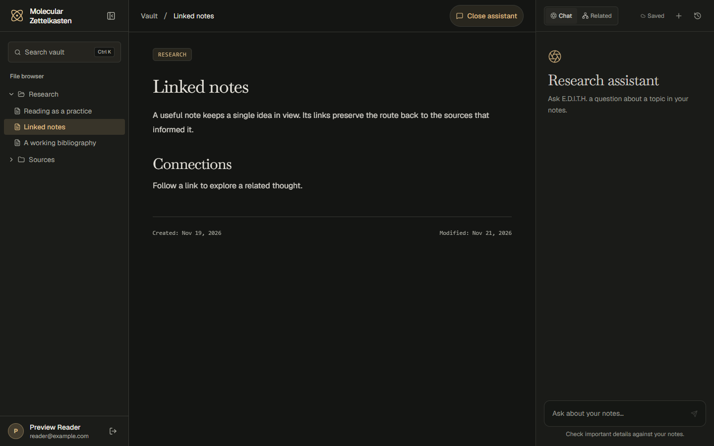
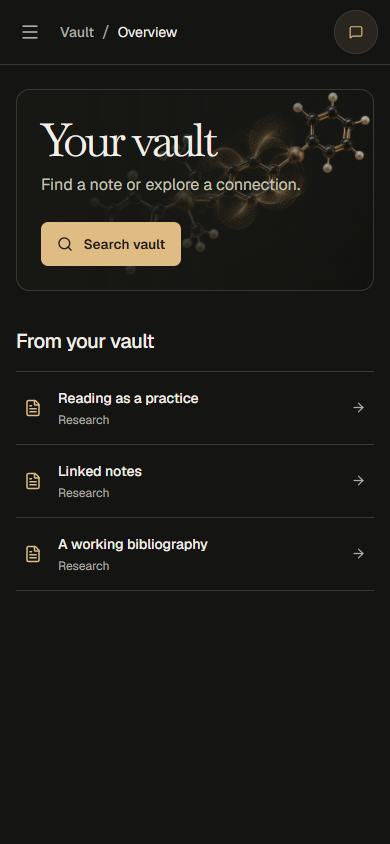
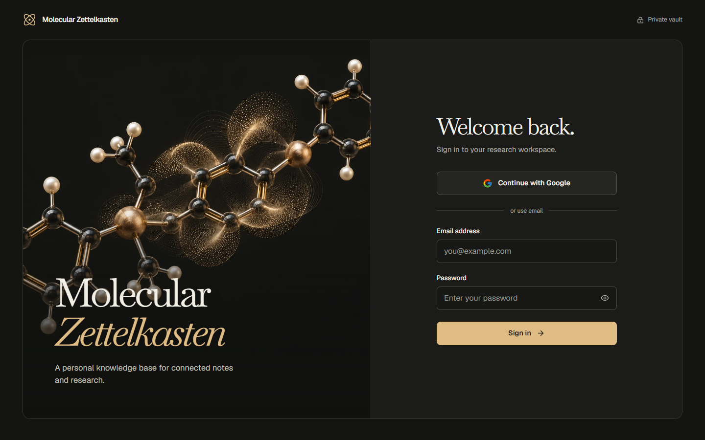
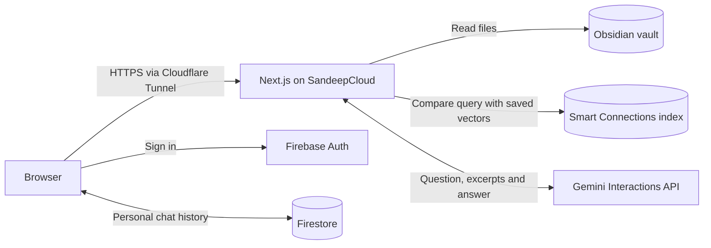

<div align="center">

# ⚛️ Molecular Zettelkasten

**A private web reader for an Obsidian vault. Find a note when you remember the idea but forget the filename. Ask E.D.I.T.H. a question, then open its citation beside the answer and read the source for yourself.**

<h3><a href="https://wiki.sandeeppokharel.com.np">Open the hosted vault »</a></h3>

[](https://github.com/pokharelsandeep333-commits/Molecular-Zettelkasten/actions/workflows/docker-build.yml)


</div>

---

## ✨ At a glance

| | |
|---|---|
| 📖 **The vault** | Write in Obsidian and read the same Markdown files in a browser. The hosted instance reads a synced copy of the vault on SandeepCloud. |
| 🔎 **Finding things** | Search by meaning using the vault’s Smart Connections index. If semantic search comes up empty, the app checks titles, tags, and excerpts. |
| 🔗 **Following a source** | A `[[wikilink]]` in a note or chat answer opens the source in the reader. The file browser expands its folder so you can see what else is there. |
| 🔒 **Who gets in** | The hosted link opens Cloudflare Access. Inside the app, Firebase checks for a verified, allowlisted email. Approved accounts share one vault and keep separate chat histories. |

## 📸 Screens

<div align="center">


<sub><b>Vault home.</b> Start with a file from the vault. After you’ve opened a few notes, this list shows your recent reads.</sub>

<br /><br />



<sub><b>The reading desk.</b> Follow a citation with the conversation still in view. Switch to Related to find other notes on the subject.</sub>

<br /><br />


&nbsp;&nbsp;


<sub><b>Phone and sign-in.</b> The file browser and assistant open as drawers on a phone.</sub>

</div>

> [!NOTE]
> The screenshots use sample notes and a preview account. The hosted vault requires access.

## 🧰 Inside the workspace

| When you want to… | Use |
|---|---|
| Find a half-remembered note | **Ctrl+K** or **⌘K** opens search. Use the arrow keys to pick a result and Enter to read it. |
| Read your original material | The reader handles Obsidian links and callouts, footnotes, KaTeX equations, Mermaid diagrams, and fenced code. Images and PDFs open in place. |
| Follow an idea beyond its links | Open **Assistant → Related** on a note. It ranks other files by similarity, including files the author never explicitly linked. |
| Return to a conversation | Choose a previous thread from chat history. Firestore syncs conversations across devices for the signed-in account. |

## 🗺️ Architecture



### What leaves the vault when you ask a question?

1. For questions under 15 words, the server asks Gemini for a short search phrase. It uses the original question if that call fails.
2. The server embeds the search text locally with `TaylorAI/bge-micro-v2` at 8-bit precision. It ranks the vault’s saved vectors by cosine similarity, then reads up to three matching notes.
3. Gemini receives the question, up to four earlier messages, and up to 3,000 characters from each matched note. A citation opens as a `[[note link]]`. If the notes don’t answer the question, E.D.I.T.H. can answer from general knowledge.

Gemini 4 Hydrogen answers by default. On a rate limit or temporary provider error, the server tries 3.8 Flash, 3.6 Flash, then 3.5 Flash-Lite, once each. Short-query expansion always uses 3.5 Flash-Lite. Both calls use `store: false`. The app maintains conversation history in the browser and Firestore. The [chat route](src/app/api/chat/route.ts) defines the models, source limits, and output budget.

## 🛡️ Access and security

| Control | Where to check it |
|---|---|
| Vault API requests require a Firebase ID token from a verified, allowlisted account. Image and PDF elements use an HTTP-only cookie scoped to `/api/raw`. | [Request guard](src/lib/firebase-admin.ts) · [Media session](src/app/api/session/route.ts) |
| A file request must resolve inside the vault. Hidden directories are excluded even when a request names them directly. | [Vault filesystem](src/lib/vault.ts) |
| Note HTML passes through a sanitizer. Diagrams render in Mermaid’s strict mode. | [Markdown pipeline](src/components/MarkdownRenderer.tsx) · [Diagram renderer](src/components/Mermaid.tsx) |
| General API traffic has a limit of 60 requests per user per minute. Chat has its own limit of 10. | [Rate limits](src/lib/rateLimit.ts) |

## 🔄 Build and release

| When | What runs |
|---|---|
| Pull request or push to `main` | ESLint, Vitest, Gitleaks, and an npm audit of production dependencies. A high or critical npm advisory fails the audit. |
| After the checks pass on `main` | GitHub Actions builds a standalone Next.js image on Debian with Node 24. Trivy scans the saved image and reports fixable high and critical findings. The workflow then publishes the commit tag and `latest` to Docker Hub. |
| On the host | Watchtower checks Docker Hub every five minutes. The vault sync runs separately, so changing a note doesn’t require an image build. |
| Weekly | Trivy rescans the published image for advisories that appeared after the build. |

The container runs as a non-root user on a Hyper-V VM. Cloudflare Tunnel carries incoming HTTPS requests without a public port on the VM. See the [build workflow](.github/workflows/docker-build.yml), [published-image scan](.github/workflows/trivy-published-image.yml), and [SandeepCloud infrastructure](https://github.com/pokharelsandeep333-commits/SandeepCloud-IAC).

## 📁 Repository layout

```text
src/app/          Sign-in, workspace, and API routes
src/components/   File browser, note reader, search, and E.D.I.T.H. sidebar
src/lib/          Vault access, vector search, authentication, and rate limits
docs/             Workspace screenshots and model notes
public/           Molecular cover artwork
.github/          Build, test, and image-scanning workflows
```

## 🚀 Run it locally

With Node.js 24 installed, clone the repository and start the dev server.

```sh
git clone https://github.com/pokharelsandeep333-commits/Molecular-Zettelkasten.git
cd Molecular-Zettelkasten
npm ci
npm run dev
```

Open [localhost:3000](http://localhost:3000) to see the sign-in screen. To open your own vault, create a gitignored `.env.local`, configure Firebase Auth, and restart the dev server.

| Setting | Value |
|---|---|
| `VAULT_PATH` | Absolute path to your Obsidian vault, outside the repository and the web root. |
| `SMART_ENV_PATH` | Directory that directly contains the Smart Connections `.ajson` files built with `TaylorAI/bge-micro-v2`. |
| `NEXT_PUBLIC_FIREBASE_API_KEY`, `NEXT_PUBLIC_FIREBASE_AUTH_DOMAIN`, `NEXT_PUBLIC_FIREBASE_PROJECT_ID`, `NEXT_PUBLIC_FIREBASE_APP_ID` | Web app configuration from your Firebase project. Enable Google or email/password sign-in and authorize your development hostname. |
| `NEXT_PUBLIC_ALLOWED_EMAILS` | Comma-separated list of verified email addresses allowed into the vault. |
| `FIREBASE_CLIENT_EMAIL`, `FIREBASE_PRIVATE_KEY` | Server-side Firebase Admin credentials. Wrap the private key in one pair of double quotes and use `\n` for line breaks. |
| `GEMINI_API_KEY` | Server-side key for E.D.I.T.H. You can browse files and use search without it. |

For chat sync, enable Firestore and restrict `users/{uid}` to the verified owner. For Docker, supply the public Firebase settings at build time and the private keys at runtime. Mount the vault read-only and use paths as seen from inside the container. The [Personal Wiki template](https://github.com/pokharelsandeep333-commits/Personal-Wiki-Template) gives you a starting folder structure.

**Check a change**

```sh
npm run lint -- --max-warnings=0
npx tsc --noEmit
npm test
npm audit --omit=dev --audit-level=high
npm run build
```

---

<div align="center">
<sub>Built by <a href="https://github.com/pokharelsandeep333-commits">Sandeep Pokharel</a> · Obsidian · Next.js · Firebase · Gemini · SandeepCloud</sub>
</div>
