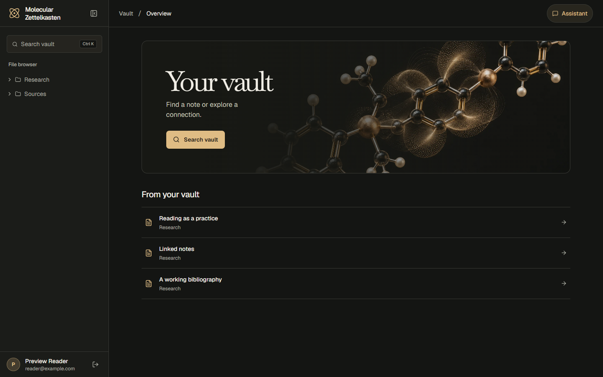

# Molecular Zettelkasten

Molecular Zettelkasten is a private web reader for an Obsidian vault. Open a note, follow its `[[wikilinks]]`, or ask E.D.I.T.H. a question and open a cited note beside the answer. The Markdown files stay in the vault. You can keep editing them in Obsidian.

[](https://github.com/pokharelsandeep333-commits/Molecular-Zettelkasten/actions/workflows/docker-build.yml)



## Finding a note

Press **Ctrl+K** or **⌘K** to search. If you remember the idea but forget what you called the note, semantic search compares your query with the Smart Connections index on the server. The search palette falls back to keyword matches across titles, tags, and excerpts. Open a result and the file browser expands to show where it lives.

Inside a note, the reader renders Obsidian callouts, diagrams, equations, and footnotes. The assistant’s **Related** tab finds other notes with similar content. On a wide screen you can keep the file browser, note, and assistant open together. On a phone, the panels open over the reader.

## Where a question goes

When you ask a short question, E.D.I.T.H. asks Gemini for search terms first. The server embeds the query locally with `TaylorAI/bge-micro-v2` in 8-bit precision, the same model and precision used to index the vault. It ranks the matches and reads up to three notes.

Gemini receives the question, up to four earlier messages, and up to 3,000 characters from each matched note. E.D.I.T.H. uses `[[note links]]` for citations. It can also answer from general knowledge when the vault has no answer. Open a citation to check what the note says.

The app calls the Gemini Interactions API with `store: false`. It keeps chat history in the browser and syncs it to the signed-in user’s Firestore document. The [chat route](src/app/api/chat/route.ts) contains the model choices and retrieval limits.

## Run it locally

Use Node.js 24. Run these commands from the repository root.

```sh
npm ci
npm run dev
```

Open [localhost:3000](http://localhost:3000). You can preview the sign-in screen without credentials. To read your own vault, create a gitignored `.env.local` with the settings below and restart the dev server.

| Setting | What to supply |
| --- | --- |
| `VAULT_PATH` | Absolute path to the folder containing your Markdown notes and attachments. |
| `SMART_ENV_PATH` | Directory that directly contains the Smart Connections `.ajson` index files. |
| `NEXT_PUBLIC_FIREBASE_API_KEY`, `NEXT_PUBLIC_FIREBASE_AUTH_DOMAIN`, `NEXT_PUBLIC_FIREBASE_PROJECT_ID`, `NEXT_PUBLIC_FIREBASE_APP_ID` | Values from your Firebase web app configuration. Enable the sign-in providers you plan to use and authorize the local hostname in Firebase Auth. |
| `NEXT_PUBLIC_ALLOWED_EMAILS` | Comma-separated list of accounts allowed to open the vault. Each account needs a verified email address. |
| `FIREBASE_CLIENT_EMAIL`, `FIREBASE_PRIVATE_KEY` | Server-side service account for the same Firebase project. Enclose the private key in one pair of double quotes and use `\n` for its line breaks. |
| `GEMINI_API_KEY` | Server-side key for the assistant. Reading notes does not use it. |

For chat sync, enable Firestore and restrict reads and writes on `users/{uid}` to the verified owner. All allowlisted accounts read the same mounted vault. Keep that vault outside the repository and the web root. The [Personal Wiki template](https://github.com/pokharelsandeep333-commits/Personal-Wiki-Template) is a starting point for a new collection.

## How the hosted vault runs

SandeepCloud runs the standalone Next.js container on a Hyper-V VM. HTTPS requests reach the VM through a Cloudflare Tunnel. The server syncs a separate copy of the Obsidian vault, so updating a note doesn’t require a new app image. The [SandeepCloud-IAC README](https://github.com/pokharelsandeep333-commits/SandeepCloud-IAC) documents the host and network.

Pull requests run ESLint, Vitest, Gitleaks, and the production dependency audit. On `main`, GitHub Actions also builds the Debian-based Node 24 image, scans it with Trivy, and pushes it to Docker Hub. Watchtower checks for a new image every five minutes. Trivy reports findings, while a high or critical npm advisory blocks the build. See the [release workflow](.github/workflows/docker-build.yml) and [Dockerfile](Dockerfile).

For a separate deployment, supply the public Firebase configuration when building the image. Provide the Admin credentials, Gemini key, and vault paths at runtime. Mount the vault read-only and point the paths at its location **inside** the container. The browser sends a Firebase ID token for API requests. Images and PDFs use an HTTP-only cookie scoped to `/api/raw`.

## Check a change

```sh
npm run lint -- --max-warnings=0
npx tsc --noEmit
npm test
npm run build
```

The [vault reader](src/lib/vault.ts) handles file access. The [Markdown renderer](src/components/MarkdownRenderer.tsx) handles note syntax, and the [design notes](DESIGN.md) cover typography and panel behavior.
